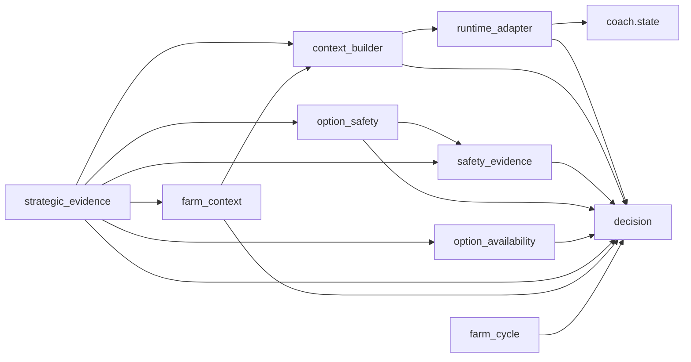

# Offline Carry Farm Decision Core v0.1

Escopo de congelamento: pipeline explícito de decisão offline, com observações
estratégicas sintéticas/de domínio fornecidas pelo chamador. A aceitação depende
de todos os gates documentados no relatório externo. Não é validação de estratégia
ótima, observabilidade real, coaching live ou MVP comercial.

## Pipeline e fronteira

```text
payload sintético -> normalize -> State -> adapt_state -> RuntimeObservation
  -> build_context_seed -> DecisionContextSeed
  + observações sintéticas de ameaças/cobertura -> build_risk_awareness
  + exposição/cobertura por opção -> build_option_safety
  + presença/acesso por opção -> build_option_availability
  + Execution explícita -> assemble_farm_evidence -> FarmEvidenceAssembly
  -> compose_farm_context -> DecisionContext -> farm_cycle.plan -> Decision
  -> authorize_output / validate_decision
```

As setas de invocação são realizadas nos testes, não por um orchestrator de produção.
Runtime não produz observações estratégicas; ameaças, cobertura, exposição e
presença/acesso entram separadamente. Nenhum módulo OfflineCore/facade foi criado.

## Responsabilidades e dependências verificadas

Imports abaixo mostram dependências locais, não bibliotecas padrão. Fonte significa
categoria contratual, não alegação de que estas fixtures vieram de uma partida real.

| Camada | Entrada -> saída | Imports locais | Responsabilidade e provenance | Não decide |
|---|---|---|---|---|
| coach.state | payload -> State | nenhum | Normaliza snapshot local; preserva propriedades active/buyback legadas | Não cria a estratégia offline |
| decision | contratos; contexto/Decision -> validação/Output | nenhum | Truth, Knownness, Freshness, fontes, resolução de suporte e invalidação | Não observa mapa nem verifica verdade mecânica das heurísticas |
| runtime_adapter | State -> RuntimeObservation escalar | coach.state, decision | Projeção declarada; RUNTIME_OBSERVATION, knownness e snapshot freshness | Não calcula risco/safety/availability/ação |
| context_builder | runtime + refs versionadas -> seed | decision, runtime_adapter | Elegibilidade; refs Knowledge/Player são lineage | Não interpreta economia ou estratégia |
| safety_evidence | seed_id + ameaças/cobertura fornecidas -> risco | decision | SAFETY_EVIDENCE; Claim heurística global | Não localiza inimigos ausentes nem certifica opção |
| option_safety | seed_id + risco + exposição/cobertura -> safety por opção | decision, safety_evidence | SAFETY_EVIDENCE; EXPERT_HEURISTIC | Não infere disponibilidade nem escolhe ação |
| option_availability | seed_id + presença/acesso -> disponibilidade | decision | SAFETY_EVIDENCE de domínio; EXPERT_HEURISTIC | Não observa/avalia risco, safety, pathing ou respawn |
| strategic_evidence | seed + envelopes + execução -> assembly | context_builder, decision, farm_context, option_availability, option_safety, safety_evidence | Valida identidades, suporte, colisões e preserva envelopes/Claims | Não autoria Truth, ranking ou ação |
| farm_context | seed + evidência + execução -> contexto | context_builder, decision | Gate de elegibilidade e resolução existente; fontes conservadas | Não chama planner nem traduz escalares em estratégia |
| farm_cycle | contexto -> Decision | decision | Ordem qualitativa aceita, execução, ação e autoridade; regra própria EXPERT_HEURISTIC | Não observa State/GSI/visão nem chama builders |
| authorize_output | Decision + contexto atual -> Output | decision (mesmo módulo) | Revalida contexto, evidência e execução; suprime obsoleto/desabilitado | Não dá permanência a uma Decision antiga |



Neste grafo, seta significa import, não chamada automática. Assembly importa o
tipo FarmStrategicEvidence, não chama compose_farm_context. O grafo é acíclico.
Service/GSI/Policy/vision não importam nem acionam esta cadeia offline.

## Invariantes congelados A–O

| ID | Invariante | Evidência do gate |
|---|---|---|
| A | Escalares não viram estratégia | Economia desconhecida e valores/herói alterados mantêm Conditions equivalentes quando evidência fornecida equivale |
| B | UNKNOWN é de primeira classe | Threat/safety/availability desconhecidos não fabricam diretiva segura |
| C | STALE não é atual | Threat stale não sustenta baixo risco; dependência stale expira Decision; NO fresco independente ainda pode decidir |
| D | Risco global difere de safety | YES não inventa farm seguro; NO não torna exposição desconhecida aceitável |
| E | Safety difere de availability | YES/UNKNOWN e UNKNOWN/YES continuam não acionáveis; NO explícito também bloqueia readiness |
| F | Assembly não autoria Truth | Claims são os mesmos objetos upstream, sem reescrever valor/ref/regra |
| G | Planner não observa mundo | Importa somente decision; recebe contexto pronto |
| H | Autoridade acompanha suporte | DIRECTIVE, ADVISORY, AWARENESS e SUPPRESS demonstrados |
| I | Binding exato | Seed estrangeiro, risco estrangeiro de mesmo Truth, ação incompatível e órfãos recusados |
| J | Provenance sobrevive | Trace legível por máquina do State até Output; fontes e regras separadas |
| K | Decisões são temporais | Evidência stale -> EXPIRED; mudança de evidência/versão/execução -> INVALID; saída suprimida |
| L | Execução importa | Rota ativa unsafe -> ABORT; perde confirmação -> HOLD, sem inventar perigo material |
| M | Opções não se contaminam | Cada opção conserva availability/safety/refs/reasons próprios; limite de uma por ação |
| N | Determinismo | Pipeline repetido igual; permutações irrelevantes preservam IDs; mudanças afetam somente camadas dependentes |
| O | Sem memória implícita | Entrada UNKNOWN após suporte anterior produz incerteza nova; sem carry-forward |

Os testes novos concentram-se nessas fronteiras. Tabelas-verdade completas locais
continuam nas suítes aceitas, sem duplicação de centenas de casos.

## Validade temporal e autoridade

- DIRECTIVE: opção suportada como disponível e aceitável; também abort de rota ativa
  explicitamente unsafe. É uma decisão sob evidência fornecida, não garantia real.
- ADVISORY: confirmação insuficiente, HOLD_AND_REEVALUATE; não significa permanecer
  fisicamente seguro no local.
- AWARENESS: risco conhecido sem rota justificável, NO_DIRECTIVE.
- SUPPRESS: Decision inválida/expirada ou output desabilitado; sem ação autorizada.

validate_decision verifica lineage/execução, dependências e identidade de contexto.
Não mede tempo de relógio: o chamador fornece o contexto atual e freshness. A
ausência de TTL real é um limite, não uma alegação de validade eterna.

## Provenance e auditoria

Runtime scalars conservam RUNTIME_OBSERVATION; não são convertidos em fatos Safety.
Fatos de domínio conservam SAFETY_EVIDENCE. Claims resolvidas conservam
EXPERT_HEURISTIC + rule_ref; planner adiciona carry_farm_cycle.offline.v1, distinto
das regras upstream. KnowledgeSnapshotRef/PlayerModelSnapshotRef são apenas IDs e
versões. O assembler não cria uma fonte estratégica própria.

O chamador deve conservar juntos RuntimeObservation, seed, FarmEvidenceAssembly,
DecisionContext e Decision/Output. Decision não embute toda a auditoria. Assembly
conserva risco e envelopes completos por opção, mais Execution; seed conserva as
refs versionadas e dimensões. Não se autentica autoria/veracidade das fixtures.

O gate exporta externamente provenance_audit.json a partir dos valores do próprio
teste test_audit_lineage_and_provenance. O teste verifica serialização e fontes; o
harness de evidência registra o resultado, sem IO introduzido no core/teste para
gravar o trace e sem outra execução do pipeline após os gates.

## Limitações classificadas

| Item | Classificação | Limite / requisito |
|---|---|---|
| A. Relevância/NEARBY/AWAY fornecidos | BLOCKER_BEFORE_LIVE_INTEGRATION | Fonte real precisa de contrato verificável; não existe aqui |
| B. Coverage fornecida | BLOCKER_BEFORE_LIVE_INTEGRATION | Sem observação/validação de wards ou mapa |
| C. Exposição fornecida | BLOCKER_BEFORE_LIVE_INTEGRATION | Sem inferência real de exposição |
| D. Presence/access fornecidos | BLOCKER_BEFORE_LIVE_INTEGRATION | Sem prova real de recurso/alcance |
| E. Freshness fornecido, sem TTL/tracker | BLOCKER_BEFORE_LIVE_INTEGRATION | Recepção/idade real exige contrato futuro explícito |
| F. Uma opção por ação | ACCEPTED_V01_LIMITATION | Duplicatas recusadas; seleção de rotas não implementada |
| G. Option Safety com risco YES não produz YES | ACCEPTED_V01_LIMITATION | Conservador por definição; fixtures independentes devem ser rotuladas |
| H. SAFETY_EVIDENCE nomeia Availability | TECH_DEBT | Origem de domínio preservada; nenhuma renomeação nesta etapa |
| I. Contexto não carrega IDs dos envelopes | ACCEPTED_V01_LIMITATION | Chamador retém assembly; requisito operacional antes de live |
| J. Knowledge/Player são apenas lineage | ACCEPTED_V01_LIMITATION | Conteúdo não é carregado ou validado |
| K. Adapter sem HP/mana/items/abilities | ACCEPTED_V01_LIMITATION | Projeção escalar declarada; mudar coleções não altera decisão offline |
| L. Sem conteúdo Data Foundation | ACCEPTED_V01_LIMITATION | Nenhum acesso/integração autorizado |
| M. Sem pipeline live | BLOCKER_BEFORE_LIVE_INTEGRATION | Composição apenas explícita em testes; não iniciar automaticamente |
| N. WinError 10054 histórico | BLOCKER_FOR_OFFLINE_CORE se reproduzido | Não aceito; ocorrência interrompe gate sem retry |
| Git ausente | TECH_DEBT | Recomendar versionamento futuro; não inicializar neste gate |

Limites A–E/M não bloqueiam a aceitação do escopo sintético offline; impedem inferir
prontidão live. O adapter marca snapshot como FRESH sem validar idade de recepção.
State.active e buyback são propriedades legadas preservadas; não são novas regras
estratégicas. A tabela FUTURE do planner é um dicionário estático de constantes,
não cache; o gate confere que a avaliação não o altera.

## Cenários e escopo das fixtures

Incluem os 37 cenários requeridos agrupados em 31 métodos: wave segura, UNKNOWN e
STALE, risco sem rota, independência safety/availability, espera produtiva, abort e
perda de confirmação, expiração/invalidação, versões, seeds/riscos estrangeiros,
órfãos, colisões, múltiplas opções/isolamento, economia opcional desconhecida,
elegibilidade, zero/False, determinismo/permutação, mudanças de ID, memória,
lineage, ausência de localização inventada, herói/itens e ausência de score.

A espera produtiva sob risco UNKNOWN usa OptionSafetyEvidence explicitamente
marcada fixture.core.independent_short_safety.v1, com fato/regra próprios e binding
correto. Não é apresentada como saída do Option Safety v0.1 nem como observação
real. Os demais passos usam os componentes aceitos, sem mocks da semântica.

## Pureza, não objetivos e congelamento

Avaliação completa de normalize até authorize_output é exercitada sob bloqueio de
IO, rede, SQLite, subprocess, clock, random/UUID e ambiente. Patches são restaurados
e inputs/constantes conferidos. Auditoria de imports/calls confirma ausência de
Service/GSI/Policy/visão/TTS/captura, sem ciclos ou chamada automática ao planner.

Não adiciona componente, estratégia, score, peso, probabilidade, herói/item mechanics,
rota/pathfinding, respawn/scheduling, observabilidade, tracking, Data Foundation,
Player Model, arbiter, Fight/Objective planner, voz/UI, adapter v0.2 ou partida real.

Baseline anterior: 311/311. Baseline consolidado: 342/342; Offline Core focal: 31/31. Todos os gates passaram uma vez, sem falhas, erros ou skips. A aceitação e a contagem
final observada ficam registradas em outputs/OFFLINE_CORE_V01_20260929 junto dos
manifests, hashes e logs. Só a classificação OFFLINE_CORE_V01_PASS_WITH_RECORDED_LIMITATIONS
nesse relatório declara o core fechado offline; não afirma validação real de Dota.

Adições canônicas autorizadas somente: tests/test_offline_core.py e este documento.
Zero modificações em produção ou testes anteriores; Git não inicializado. Cada
gate roda uma vez; qualquer falha, inclusive falso positivo novo, encerra a etapa
sem correção/retry. Após revisão, nenhuma etapa seguinte é iniciada automaticamente.
